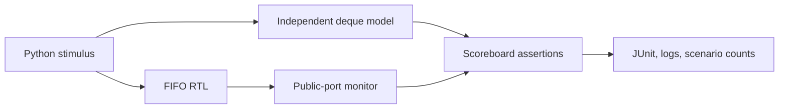
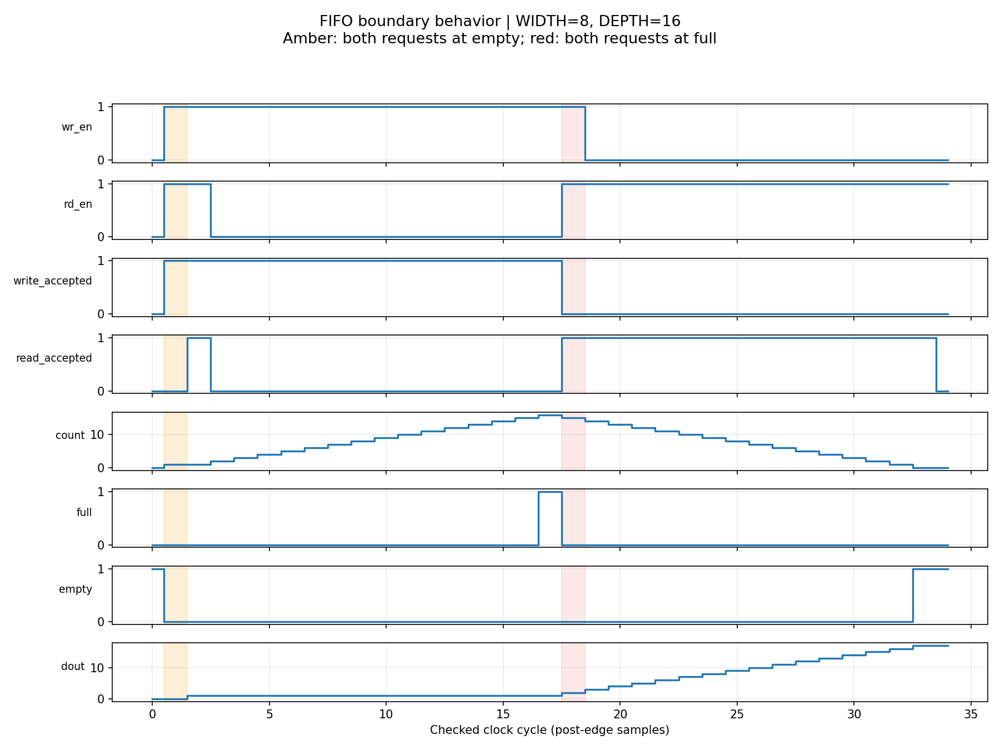

# SystemVerilog FIFO with Python/cocotb Verification

[](https://github.com/sonisiiuu7/systemverilog-fifo-cocotb-verification/actions/workflows/verify.yml)

A synthesizable, parameterized synchronous FIFO and an independent Python scoreboard. The project demonstrates RTL design, boundary-case analysis, automated simulation, seeded randomized verification, and debugging for an ASIC design/verification internship portfolio.

**Verified baseline:** 10 directed tests + 10 seeded random tests pass at WIDTH=8, DEPTH=16. Each seed runs 1,000 randomized cycles plus a boundary prelude and drain. All 15 required functional scenario bins are exercised per seed. Three deliberate RTL faults are detected. These are simulation results, not formal proof, silicon validation, or HDL code-coverage claims.

**Parameter extension:** all 120 tests pass across (WIDTH, DEPTH) = (1,2), (8,3), (5,5), (8,16), (16,17), and (32,32), totaling 60,000 randomized cycles plus deterministic preludes and drains. See [the execution summary](results/phase7/summary.json).

## Architecture



The FIFO stores data in an array, tracks read/write positions, and maintains occupancy. Reads return the oldest item through a registered output. Accepted simultaneous transfers leave occupancy unchanged. Reset is synchronous and has highest priority.

| Condition before edge | Write request | Read request | Result |
|---|---|---|---|
| Empty | 1 | 1 | Write only; no bypass |
| Partial occupancy | 1 | 1 | Both accepted |
| Full | 1 | 1 | Read only; write rejected |

See the complete [interface and specification](docs/spec.md), [architecture explanation](docs/architecture.md), and [verification plan](docs/test_plan.md).

## Quick start

Requirements: Python 3.11, Git, and Icarus Verilog on PATH. The local evidence was generated with Python 3.11.9, cocotb 2.0.1, and Icarus 13.0 on Windows x64. Python packages are pinned in requirements.txt. No FPGA board or commercial simulator is required.

### Windows PowerShell

```powershell
git clone https://github.com/sonisiiuu7/systemverilog-fifo-cocotb-verification.git
cd systemverilog-fifo-cocotb-verification
powershell -ExecutionPolicy Bypass -File scripts/bootstrap.ps1
powershell -ExecutionPolicy Bypass -File scripts/verify.ps1
```

The bootstrap creates only project-local `.venv` and `.tools` directories. It downloads a checksum-verified Icarus binary and uses the existing Git for Windows zlib DLL when necessary. It does not change the global PATH. `-ExecutionPolicy Bypass` applies to that process, not the machine configuration.

For the baseline, all three mutation checks, and the complete parameter sweep together:

```powershell
powershell -ExecutionPolicy Bypass -File scripts/verify.ps1 -Mutations -Sweep
```

This reruns and updates the corresponding mutation/sweep result files. Historical evidence remains available in Git history.

### Ubuntu / Linux

```bash
sudo apt-get update
sudo apt-get install -y iverilog python3-venv
python3 -m venv .venv
source .venv/bin/activate
python -m pip install -r requirements.txt
python scripts/run.py --phase local --suite random
python scripts/mutate.py
python scripts/sweep.py
```

Use an Icarus version compatible with cocotb 2.0.1 (11.0 or later). The GitHub workflow records the installed simulator version in its logs.

## Running individual stages

With the environment active and `iverilog`/`vvp` on PATH:

```bash
python scripts/run.py --phase local-smoke --suite smoke
python scripts/run.py --phase local-basic --suite basic
python scripts/run.py --phase local-directed --suite directed
python scripts/run.py --phase local-random --suite random
python scripts/run.py --phase local-wave --suite directed --waves
python scripts/run.py --phase local-depth3 --suite random --width 8 --depth 3
python scripts/mutate.py
```

`--phase` selects a subdirectory under results; use `local-*` to preserve historical phase evidence. Basic runs only the transfer test; directed runs ten tests; random runs all twenty. Skipped tests are reported separately. The runner returns nonzero on simulation/test failure, saves JUnit XML and a transcript, and records the RTL SHA-256. Waveforms are generated only with `--waves`; open the resulting FST in GTKWave.

Mutation runs intentionally overwrite the reproducible `results/phase5` mutation subdirectories. Their failing JUnit files mean the deliberately broken copies were detected. The mutation command succeeds only when all three faults produce behavioral assertion failures. The production RTL remains unchanged.

## Evidence and project phases

| Phase | Work | Evidence |
|---|---|---|
| 1 | Specification and simulator setup | [Smoke results](results/phase1) |
| 2 | FIFO RTL and basic scoreboard | [Ordered-transfer results](results/phase2) |
| 3 | Directed boundary verification | [10 passing tests](results/phase3) |
| 4 | Random traffic and scenario gates | [20 passing tests](results/phase4) |
| 5 | Fault injection and waveform inspection | [Mutation summary](results/phase5/mutation_summary.json), [passing rerun](results/phase5/restored), [debug notes](docs/debug_notes.md) |
| 6 | Documentation and reproducible automation | [Release checks](results/phase6), [CI workflow](.github/workflows/verify.yml) |
| 7 | Parameter sweep extension | [Six configurations, 120 passing tests](results/phase7/summary.json) |



## Repository layout

```text
rtl/          Synthesizable FIFO
tb/           cocotb tests, independent queue model, simulator smoke test
scripts/      Simulation runner, mutation checks, setup, plotting, sweep
docs/         Specification, test plan, architecture, debugging and interview guide
results/      Committed execution evidence by phase
.github/      Automated verification workflow
```

## Scope and limitations

This is a single-clock educational FIFO, not a complete Cisco product or a networking protocol block. It has no asynchronous CDC, AXI interface, packet parsing, UVM environment, technology mapping, static timing analysis, or physical-design results. The supported parameter contract is WIDTH>=1 and DEPTH>=2; explicitly tested combinations are listed in the parameter report. Synthesis suitability follows the RTL structure; no synthesis/PPA result is claimed. Memory is not reset because occupancy determines validity. A full FIFO rejects writes even when a read occurs on the same edge.

## Learning and attribution

Start with the [architecture and walkthrough](docs/architecture.md) and [interview guide](docs/interview_guide.md). This project was developed with AI assistance. Be prepared to explain the RTL, independently rerun the tests, and modify a test or design behavior before presenting it as portfolio work.

Primary tool references: [cocotb 2.0 installation](https://docs.cocotb.org/en/v2.0.0/install.html), [Python runner](https://docs.cocotb.org/en/v2.0.0/runner.html), [Icarus installation](https://steveicarus.github.io/iverilog/usage/installation.html).
