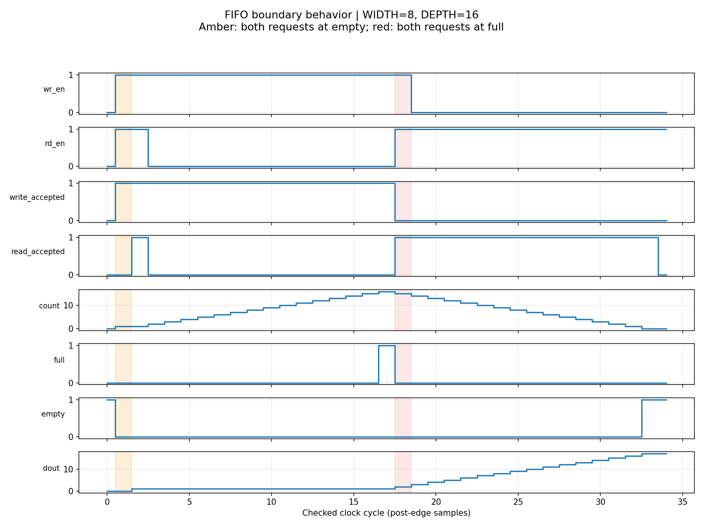

# Debugging and fault-injection evidence

## Setup issue resolved

The portable Windows Icarus 13.0 distribution loaded without zlib1.dll but reported an error loading system.vpi. The existing 64-bit zlib1.dll from Git for Windows was copied into the project-local simulator bin directory. The smoke simulation was rerun cleanly before the Phase 1 commit. No global PATH or system installation was changed.

## Deliberate RTL fault injection

These are intentional experiments, not claims of naturally discovered design bugs. `python scripts/mutate.py` writes separate RTL copies under build/mutations. Production RTL is never edited. Detection requires simulator JUnit failures AND a scoreboard AssertionError; compilation/tool failures do not qualify.

| Fault | First observed failure | Explanation |
|---|---|---|
| Full asserted at DEPTH-1 | fill_drain cycle 15: full=1, expected 0 | Capacity flag asserts one write too soon |
| Write ignores full | overflow_protection cycle 17: count=17, expected 16 | Rejected write incorrectly changes occupancy |
| Read pointer stops advancing | basic cycle 5: dout=17, expected 18 | Second read repeats old data |

All three faults were detected. See [machine-readable summary](../results/phase5/mutation_summary.json). Failed JUnit reports in mutation subdirectories are expected evidence. The restored directory contains the passing production-RTL regression.

## Boundary trace

This plot is generated from actual post-edge samples in boundaries.csv. At cycle 1, both enables are high on an empty FIFO: only the write succeeds, count becomes 1, and dout remains zero. At cycle 2, both operations succeed. At cycle 18, both enables are high on a full FIFO: only the read succeeds and count falls from 16 to 15. The following drain verifies that rejected data was not appended.

The continuous simulator waveform is [sync_fifo.fst](../results/phase5/restored/sync_fifo.fst), viewable in GTKWave. The PNG is a sampled signal plot, not a screenshot of a waveform viewer. Regenerate it with `python -m pip install matplotlib==3.10.8` followed by `python scripts/plot_trace.py`.
